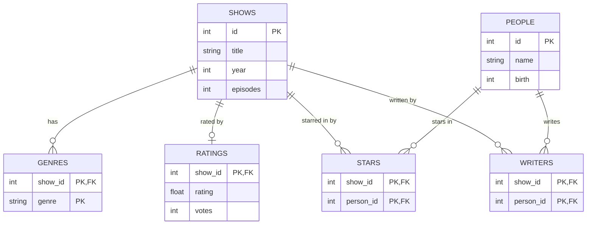

# TV Shows ERD

## Assumptions

- Shows and people get a numeric id (IMDb's), because titles and names are not unique. Eight shows are called The Office.
- year is the year the show first aired. birth is a year only, matching "born 1962", and can be NULL when unknown.
- Genres live in their own table, one row per show per genre, because a show can have several. The genre is stored as text, with no separate genre lookup table.
- Ratings live in their own table with show_id as the primary key. So a show has zero or one rating, and unrated shows simply have no row instead of NULLs.
- There is one PEOPLE table for stars and writers, because the same person can do both. STARS and WRITERS are join tables for the two many-to-many links.
- episodes is stored as a count on the show. There is no table for individual episodes, since neither page lists them.
- Billing order of the stars is not stored. The pages don't show that it matters, and it could be added later as an int column on STARS.
- "and 17 more" on the person page is a count of their STARS rows, not a stored number.
- Only TV series are modeled. The "TV series" label is the same for every show, so there is no type column.
