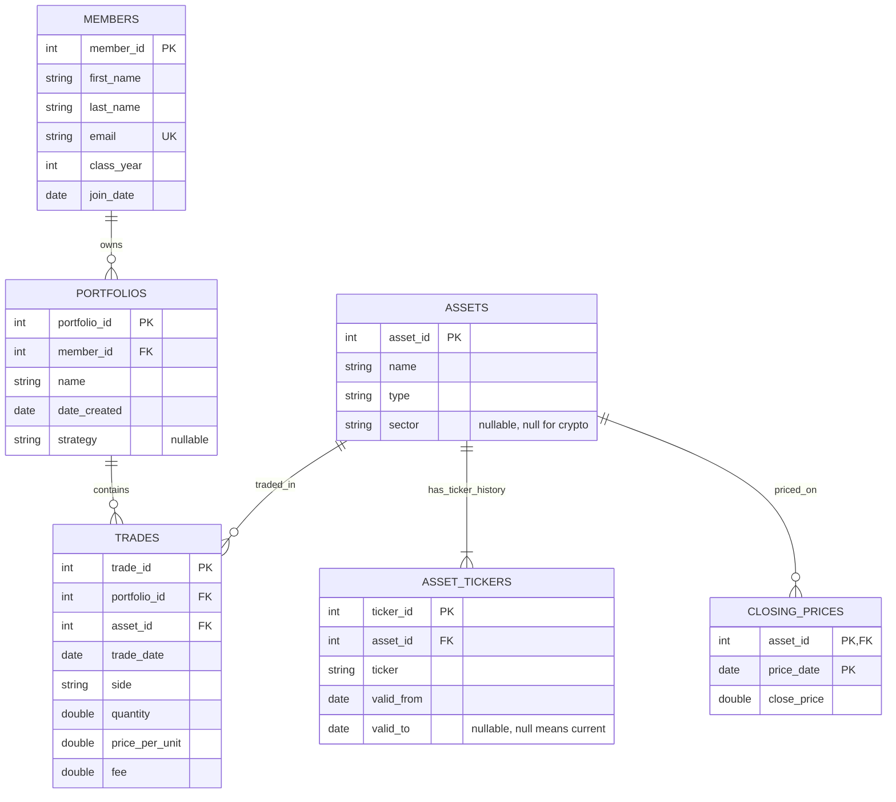

# Babson Investment Club Database

## The Scenario

I chose Scenario B: Babson Investment Club. The club runs paper (practice)
portfolios so members can learn investing without real money, but today
everything lives in a shared spreadsheet and broker screenshots. The database
needs to give a clear, trustworthy history of every trade, plus a way to see
what each portfolio holds.

## The ERD

## What One Row Means

One row of members is one person who belongs to the club.

One row of portfolios is one paper portfolio owned by one member.

One row of assets is one tradable thing, a stock, an ETF or a crypto, tracked
across any ticker changes it has.

One row of asset_tickers is one period during which one asset was known by
one ticker symbol.

One row of closing_prices is the official closing price of one asset on one
trading day.

One row of trades is one buy or sell of one asset by one portfolio on one
day.

## Design Choices

a. Keys the business already had. I could have used each member's school email as their ID, but emails can change, so I gave every member a simple number instead and made sure no two members share an email. Tickers cannot be IDs either, because a ticker can change while the company stays the same, like Facebook becoming META. So every asset has its own number, and its tickers go in a separate table with the dates each one was used.

b. Optional relationships. The scenario says a member can own several portfolios or none, so a member does not need a portfolio, but every portfolio must belong to one member. Some assets are followed but never traded, and a new portfolio may not have traded yet, so neither needs to have trades. Strategy and sector can be left blank, because the scenario says strategy is optional and crypto has no sector.

c. Rules the tables cannot hold. The database itself stops most rule breaks. For example, it refuses a trade with a negative quantity, and it refuses a second trade by the same portfolio in the same asset on the same day. It cannot hold two rules, so I check those with queries instead. Question 7 finds trades on a day with no closing price. Question 8 finds sells of more units than the portfolio held at the time. A table rule only looks at one row, and the Question 8 rule needs all the earlier trades added up.

d. Something I changed. The agent first suggested making the database refuse any trade on a day with no closing price. I did not keep that, because the assignment asks my data to break that rule on purpose in two rows. So I check it with a query in Question 7 instead.
