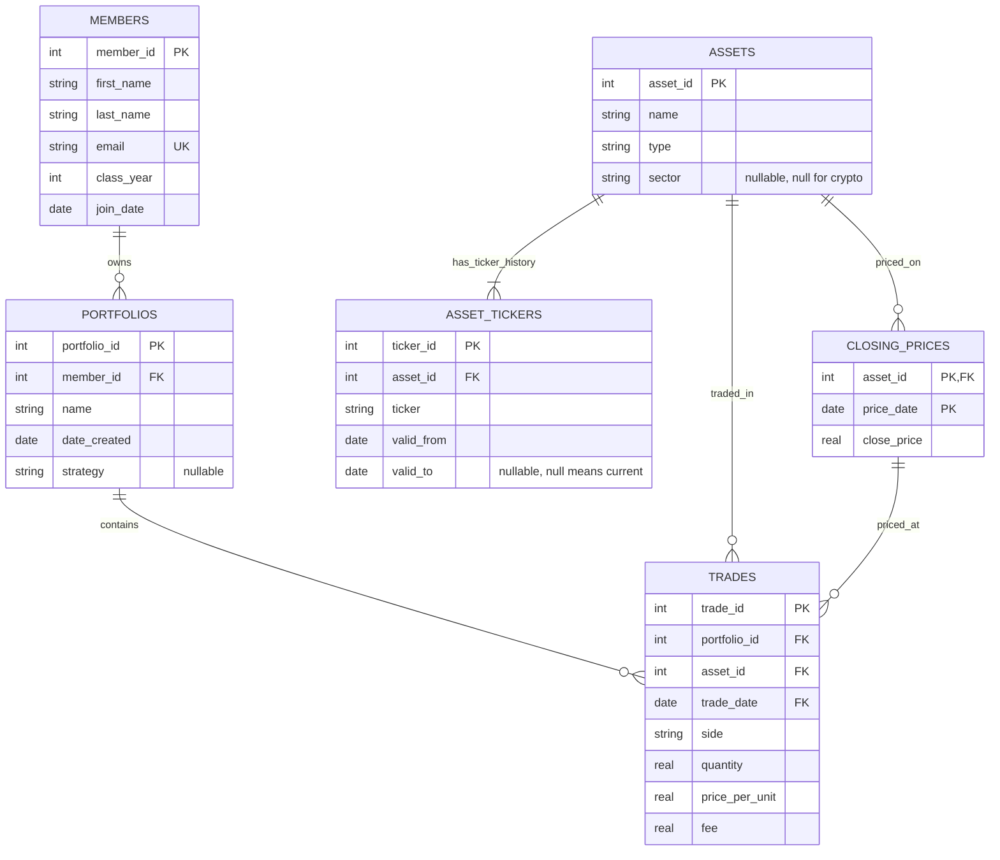

# Babson Investment Club Database

## The Scenario

I chose Scenario B: Babson Investment Club. The club runs paper (practice)
portfolios so members can learn investing without real money, but today
everything lives in a shared spreadsheet and broker screenshots. The database
needs to give a clear, trustworthy history of every trade, plus a way to see
what each portfolio holds and what it is worth on any given day.

## The ERD

## What One Row Means

One row of members is one person who belongs to the club.

One row of portfolios is one paper portfolio owned by one member.

One row of assets is one tradable thing, a stock, an ETF or a crypto, tracked
across any ticker changes it has.

One row of asset_tickers is one period during which one asset was known by
one ticker symbol.

One row of closing_prices is the official closing price of one asset on one
trading day.

One row of trades is one buy or sell of one asset by one portfolio on one
day.

## Design Choices

a. Keys the business already had. Members could be keyed by school email, but I used a surrogate member_id and made email UNIQUE NOT NULL, because an email can change and is long to repeat as a foreign key in portfolios. Assets cannot use the ticker as a key at all, since a ticker can change while the asset stays the same (Facebook to META). So assets get a surrogate asset_id, and tickers live in asset_tickers with valid_from and valid_to, which lets both tickers point at the same asset.

b. Optional relationships. A member may own several portfolios or none, so portfolios are optional on the member side, but every portfolio must belong to exactly one member. Assets and portfolios can both have zero trades, since some assets are followed but never traded and a new portfolio has not traded yet. Strategy and sector are nullable because the scenario calls strategy optional and crypto has no sector.

c. Rules the tables cannot hold. Rules 1 to 7 are held by keys and constraints, including a composite foreign key from trades (asset_id, trade_date) to closing_prices for rule 7, and build.py will turn on PRAGMA foreign_keys = ON so SQLite actually enforces them. Rule 8 cannot be a constraint, because it means adding up earlier trades and a constraint only sees one row. I will check it with a query that keeps a running total of units per portfolio and asset, ordered by trade_date, and lists any sell where the total drops below zero. Rule 2 means there is at most one trade per day for each pair, so the ordering has no ties.

d. Something I changed. The agent's first draft said rule 7 was enforced by a composite foreign key from trades to closing_prices, but the ERD it drew did not show that relationship, and trade_date was not marked as a foreign key. I added the CLOSING_PRICES to TRADES relationship and marked trade_date as FK so the diagram matches the design. I also added the note that SQLite only enforces foreign keys with PRAGMA foreign_keys = ON, since without it the rule 7 claim would not be true.
